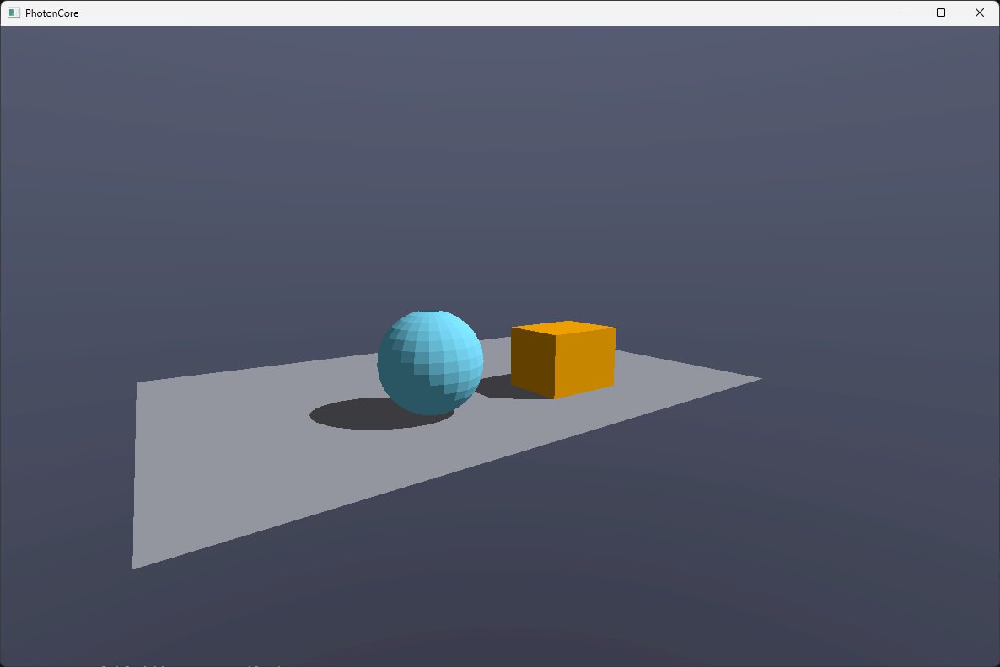

<div align="center">

# PhotonCore

### Engine di Ray Tracing in tempo reale in C++17 e Vulkan Compute Shaders

Un motore di ray tracing **senza estensioni hardware dedicate** (`VK_KHR_ray_tracing`), implementato da zero in C++ nativo su API Win32 e Vulkan 1.2, con pipeline di calcolo parallelo tramite Compute Shader.

**C++17** · **Vulkan 1.2** · **GLSL Compute** · **Win32 API**

[Architettura](#architettura) · [Avvio rapido](#avvio-rapido) · [Come funziona](#come-funziona) · [Struttura](#struttura-del-progetto)

</div>

---

## Il progetto

Questo progetto esplora l'intera pipeline di un ray tracer basato su Compute Shader: generazione dei raggi primari in GPU, intersezioni raggio-triangolo (algoritmo Möller–Trumbore), ombre direzionali (shadow rays) e gestione dinamica della Swapchain al ridimensionamento della finestra Win32.

<div align="center">
    
</div>

*Scena 3D generata in tempo reale: la camera orbitale permette di ruotare e zoomare attorno agli oggetti con calcolo delle ombre direzionali.*

## Architettura

Il flusso di esecuzione e rendering è:

```text
Host CPU (Win32 Event Loop) → SSBO & Push Constants → VkCmdDispatch (Compute Shader) → Storage Image → VkCmdBlitImage → Swapchain Present
```

| Componente | Ruolo / Operazione | Target / Formato |
|---|---|---:|
| **WinINIT** | Finestra Win32 nativa e Swapchain Vulkan | `B8G8R8A8_SRGB` |
| **ObjRender** | Generatore di mesh (Sfere UV, Parallelepipedi, Piani) | `std::vector<Triangle>` |
| **TriangleBuffer** | Storage Buffer Object (`std430`) caricato in VRAM | `VK_BUFFER_USAGE_STORAGE_BUFFER_BIT` |
| **Raytrace Shader** | Dispatch per pixel (`16 × 16` local workgroup size) | `RGBA8_UNORM` Storage Image |
| **Camera Uniform** | Push constants per posizione camera e target | `sizeof(CameraUniform)` |

La camera calcola la direzione del raggio per ogni coordinate di schermo normalizzate (NDC) corregge l'aspect ratio secondo la formula:

$$ndc_x = \left( \frac{2 \cdot (x + 0.5)}{w} - 1 \right) \cdot \frac{w}{h}$$

$$ndc_y = -\left( \frac{2 \cdot (y + 0.5)}{h} - 1 \right)$$

dove $w$ e $h$ rappresentano rispettivamente la larghezza e l'altezza della finestra in pixel.

## Come funziona

### Generazione dei Raggi (Ray Generation)

Ogni thread del Compute Shader calcola un raggio $R(t) = O + t \cdot D$, dove $O$ è la posizione della camera `camPos` e $D$ è la direzione normalizzata ottenuta dalla matrice di vista semplificata:

$$D = \text{normalize}(F \cdot f + R \cdot ndc_x + U \cdot ndc_y)$$

con $F$ (forward), $R$ (right) e $U$ (up) derivati dal vettore `camTarget - camPos`.

### Intersezione Raggio-Triangolo (Möller–Trumbore)

Il calcolo dell'intersezione tra un raggio ed un triangolo con vertici $\vec{P}_0, \vec{P}_1, \vec{P}_2$ usa l'algoritmo Möller–Trumbore privo di memorizzazione del piano della faccia:

$$\vec{E}_1 = \vec{P}_1 - \vec{P}_0, \quad \vec{E}_2 = \vec{P}_2 - \vec{P}_0$$

$$\vec{T} = O - \vec{P}_0, \quad \vec{P} = D \times \vec{E}_2, \quad \vec{Q} = \vec{T} \times \vec{E}_1$$

$$\begin{bmatrix} t \\ u \\ v \end{bmatrix} = \frac{1}{\vec{P} \cdot \vec{E}_1} \begin{bmatrix} \vec{Q} \cdot \vec{E}_2 \\ \vec{P} \cdot \vec{T} \\ \vec{Q} \cdot D \end{bmatrix}$$

### Ombre Direzionali (Shadow Rays)

Se il raggio colpisce una superficie ad una distanza $t > 0.001$, viene generato un raggio ombra secondario con origine $\vec{H}_{pos} + \vec{N} \cdot 0.001$ diretto verso la sorgente luminosa $\vec{L}_{dir}$. Se il raggio ombra interseca un qualsiasi altro triangolo della scena, il contributo diffusivo della luce viene azzerato.